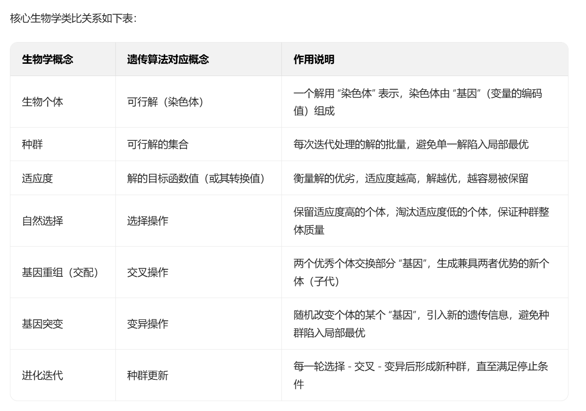
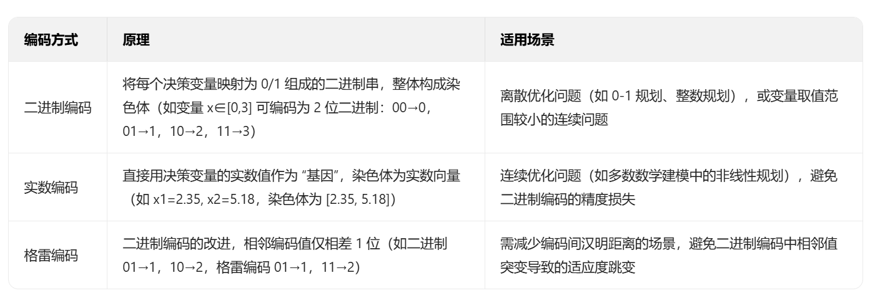
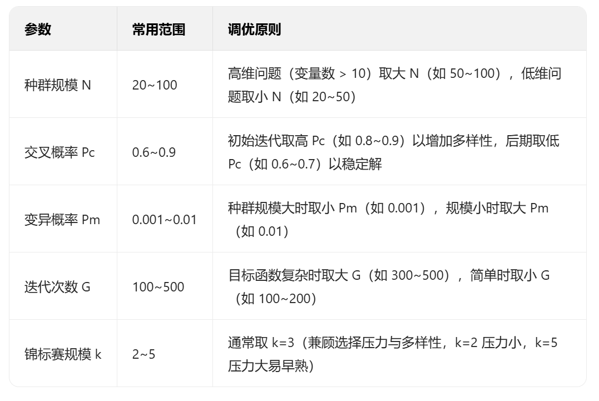

今天我们来学习两种启发性算法：遗传算法与模拟退火算法法，当题目的约束条件较为复杂，难以使用常规算法进行求解时，我们可以尝试使用以上两种算法，通过模拟自然现象或生物行为的通用策略，在可接受的时间内寻找复杂优化问题的近似最优解。本文文案来自豆包。
# 一、遗传算法
## 1、遗传算法的概述
遗传算法的灵感源自达尔文的进化论，将优化问题中的 “可行解” 类比为生物 “个体”，“解的质量” 类比为 “个体适应度”，通过模拟生物的**选择、交叉、变异**三大进化操作，驱动种群向 “适应度更高”（即解更优）的方向进化。以下是遗传算法中各名词的含义：

## 2、遗传算法的核心步骤
遗传算法的迭代流程具有强规范性，数学建模中需严格按步骤实现，关键在于**编码方式、适应度函数、遗传操作、参数设置**四大模块的设计。以下是标准流程的详细拆解：
### 步骤 1：问题建模与编码（将 “解” 转化为 “染色体”）
编码是遗传算法的基础 —— 需将优化问题的决策变量转化为计算机可处理的 “染色体”（通常是二进制串或实数串）。编码方式直接影响算法效率，需根据问题类型选择：

**建模示例**：若优化问题为 “最小化 f (x1,x2)=x1²+x2²，s.t. x1∈[0,5], x2∈[0,5]”，采用实数编码时，染色体可表示为 [x1, x2]，其中 x1 和 x2 为 [0,5] 内的实数。

### 步骤 2：初始化种群（生成初始可行解集合）
种群是迭代的起点，需随机生成一定数量的 “个体”（可行解），种群规模 N 的选择需平衡效率与多样性：
- **种群规模 N**：太小易导致种群多样性不足，陷入局部最优；太大则增加计算量，降低迭代速度。数学建模中常用 N=20~100（需根据问题复杂度调整，如高维问题取较大 N）。
- **初始化方法**：在决策变量的约束范围内随机生成个体（如上述示例中，x1 和 x2 各随机取 [0,5] 内的实数，生成 N 个 [x1,x2] 向量作为初始种群）。

### 步骤 3：计算适应度（评估解的优劣）
适应度函数是遗传算法的 “指挥棒”，需将优化问题的**目标函数**转化为 “适应度值”（适应度越高，解越优），核心是处理 “最小化” 与 “最大化” 的转换，以及约束条件。
#### （1）目标函数与适应度的转换
- 若问题为**最大化目标函数 f (x)**：直接令适应度函数 F (x)=f (x)（适应度与目标函数值正相关）。
- 若问题为**最小化目标函数 f (x)**：需将其转换为最大化问题，常用方法：
  - 倒数法：F (x)=1/(f (x)+C)（C 为常数，避免 f (x) 为 0 时分母为 0）；
  - 负数值法：F (x)=M - f (x)（M 为 f (x) 的上界，需根据问题估计）。

#### （2）约束条件的处理（关键！数学建模常考）
若问题含约束（如 g (x)≤0, h (x)=0），需通过 “惩罚机制” 将不可行解的适应度降低，避免其被保留。常用惩罚函数法：
- 对不可行解，在适应度中加入惩罚项，公式为：F'(x) = F(x) - P(x)，其中 P (x) 为惩罚项（不可行程度越严重，P (x) 越大）。

示例：若约束为 x1+x2≤6，对 x1+x2>6 的个体，惩罚项可设为 P (x)=k*(x1+x2-6)（k 为惩罚系数，需调试，如 k=100）。

### 步骤 4：遗传操作（核心迭代环节）
遗传操作包括**选择、交叉、变异**，是驱动种群进化的关键，需按顺序执行：
#### （1）选择操作：保留优秀个体
选择的目的是从当前种群中筛选出适应度高的个体，作为 “父代” 参与后续交叉。常用方法：

**建模建议**：优先使用 “锦标赛选择 + 精英保留”，兼顾多样性与收敛速度。

#### （2）交叉操作：生成子代（核心创新环节）
交叉是遗传算法产生新解的主要方式，通过父代个体交换基因，生成兼具两者特征的子代。交叉概率 Pc（如 Pc=0.6~0.9）控制交叉发生的频率（Pc 太低保真度低，太高易破坏优秀基因）。
不同编码方式对应不同交叉方法：
- **二进制编码→单点交叉 / 两点交叉**：
  - 单点交叉：随机选择一个交叉点，交换父代交叉点后的基因（如父代 1：0011|01，父代 2：1100|10，交叉后子代 1：001110，子代 2：110001）；
- **实数编码→算术交叉 / 模拟二进制交叉（SBX）**：
  - 算术交叉：子代基因 =α* 父代 1 基因 + (1-α)* 父代 2 基因（α 为 [0,1] 内的随机数，如父代 1:x1=2.0，父代 2:x1=4.0，α=0.3，子代 x1=2.6）；
  - SBX：更适合连续优化，模拟二进制编码的交叉特性，生成的子代更接近父代，保证解的合理性。

**建模建议**：连续优化问题优先用 SBX 交叉，离散问题用单点交叉。

#### （3）变异操作：引入新基因（避免局部最优）
变异是遗传算法维持种群多样性的关键，通过随机改变个体的某个基因，引入新的可行解，避免种群 “早熟”。变异概率 Pm（如 Pm=0.001~0.01）需极小（Pm 太大会导致算法退化为随机搜索）。
不同编码方式对应不同变异方法：
- **二进制编码→位翻转变异**：随机选择一个基因位，将 0 变为 1 或 1 变为 0（如染色体 001101→变异后 001001）；
- **实数编码→高斯变异**：对选中的基因，在其当前值基础上叠加一个高斯随机数（如 x1=2.35，变异后 x1=2.35 + N (0,σ²)，σ 为标准差，控制变异幅度）

**建模建议**：实数编码用高斯变异，σ 可随迭代次数减小（前期大变异探索解空间，后期小变异精细搜索）。

### 步骤 5：判断停止条件（迭代终止）
当满足以下任一条件时，算法停止，输出当前种群中的最优个体作为最终解：
- 1、迭代次数达到预设值（最常用，如迭代 100~500 次，需根据问题复杂度调整）；
- 2、最优适应度值连续多代（如 10 代）无明显改进（说明算法收敛到稳定解）；
- 3、最优适应度值达到预设精度（如目标函数值与理论最优值的差小于 1e-6，若已知理论最优）。

## 3、遗传算法的关键参数调优（数学建模得分关键）
遗传算法的性能高度依赖参数设置，不当的参数会导致 “早熟”（陷入局部最优）或 “收敛慢”。以下是核心参数的调优建议：

**调优技巧**：可通过 “控制变量法” 测试不同参数组合（如固定 N=50、G=300，测试 Pc=0.7、0.8、0.9 的效果），选择最优参数。

## 4、遗传算法在数学建模中的典型应用场景
遗传算法在数模比赛中应用广泛，尤其适合以下问题：
- **函数优化问题**：如非线性、非凸、多峰函数的极值求解（传统梯度法易陷入局部最优，GA 可通过种群多样性找到全局最优）；
- **组合优化问题**：如旅行商问题（TSP）、背包问题、车辆路径规划（VRP）（NP-hard 问题，枚举法无法求解，GA 可快速找到近似最优解）；
- **多目标优化问题**：如 “最小化成本 + 最大化收益”（需结合非支配排序遗传算法 NSGA-II，生成 Pareto 最优解集）；
- **带约束的优化问题**：如工程设计中的多约束优化（通过惩罚函数处理约束，无需满足 KKT 条件）。

## 5、遗传算法的优缺点与改进方向
### 优点
- 鲁棒性强：不依赖目标函数的连续性、可微性，适用于各类复杂优化问题；
- 全局搜索能力：通过种群迭代和变异操作，能有效避免局部最优；
- 易实现：核心步骤（选择、交叉、变异）逻辑清晰，可通过 Python（如deap库、scipy库）或 MATLAB 快速编程实现。
### 缺点
- 收敛速度慢：后期种群多样性降低，迭代效率下降；
- 参数敏感：种群规模、交叉 / 变异概率等参数需反复调试；
- 局部搜索精度不足：相比梯度下降等局部优化方法，最终解的精度可能较低。
### 改进方向（数模加分点）
- 混合算法：结合局部优化方法（如 GA + 梯度下降），先用 GA 全局搜索，再用梯度下降精细优化；
- 自适应参数：让 Pc、Pm 随迭代次数动态调整（如适应度方差大时增大 Pc，方差小时增大 Pm）；
- 多目标改进：采用 NSGA-II、MOEA/D 等多目标遗传算法，处理多目标优化问题；
- 精英策略增强：保留多代最优个体，避免优秀基因丢失。
**具体代码实现需具体情况具体分析**

# 二、模拟退火算法
## 1、模拟退火算法的概述
模拟退火算法的灵感源于物理中的**金属退火过程**：
金属加热到高温时，原子动能大，可自由运动（对应算法的 “随机搜索”）；随着温度缓慢降低，原子动能减小，逐渐趋于稳定排列（对应算法的 “局部微调”）；若降温过快，原子会被困在无序状态（对应算法陷入 “局部最优”）。
算法将这一过程映射为优化问题：
- “**温度 T**”：控制搜索的 “随机性”—— 高温时允许接受较差的解（探索新区域），低温时只接受更优解（ exploitation，精炼当前区域）。
- “**能量 E**”：对应优化问题的 “目标函数值”（如 TSP 中的总路程、函数优化中的函数值），算法的目标是找到 “能量最低” 的状态（即目标函数最小 / 最大值）。
- “**Metropolis 准则**”：决定是否接受新解的核心规则 —— 即使新解比当前解差，也有一定概率接受它，概率随温度降低而减小（这是 SA 跳出局部最优的关键）。

## 2、算法核心原理与关键公式
### （1） Metropolis 准则（接受新解的概率）
设当前解为 \(S_{\text{curr}}\)，其目标函数值为 \(f(S_{\text{curr}})\)；通过随机扰动生成新解 \(S_{\text{new}}\)，其目标函数值为 \(f(S_{\text{new}})\)。定义 “能量差” \(\Delta f = f(S_{\text{new}}) - f(S_{\text{curr}})\)：
- 若 \(\Delta f \leq 0\)（新解更优）：直接接受新解（\(S_{\text{curr}} \leftarrow S_{\text{new}}\)）。
- 若 \(\Delta f > 0\)（新解更差）：以概率 \(P = e^{-\Delta f / T}\) 接受新解 —— 温度 T 越高，P 越大（越容易接受差解，探索新区域）；T 越低，P 越小（几乎不接受差解，锁定最优区域）。

### （2） 温度衰减策略（降温 schedule）
温度的降低方式直接影响算法性能：降温过快会陷入局部最优，降温过慢则耗时过长。数模中常用的降温策略有：
- **指数降温（最经典）**：\(T_{k+1} = \alpha \cdot T_k\)，其中 \(\alpha \in [0.8, 0.99]\)（称为 “降温系数”）。
  - 例：初始温度 \(T_0=1000\)，\(\alpha=0.95\)，则第 2 轮温度 \(T_1=950\)，第 3 轮 \(T_2=902.5\)，以此类推，温度缓慢下降。‘
- **线性降温**：\(T_{k+1} = T_k - \beta\)（\(\beta\) 为固定降温步长），但后期易因 T 骤降导致搜索不充分，较少单独使用。

### （3） 迭代终止条件
算法需设定终止条件，避免无限循环。数模中常用：
- **温度阈值**：当温度 \(T_k \leq T_{\text{min}}\)（如 \(T_{\text{min}}=1e-8\)）时，终止迭代（此时已无概率接受差解，搜索稳定）。
- **迭代次数**：设定最大迭代轮数（如 1000 轮），或连续多轮（如 100 轮）目标函数值无改进时终止。

## 3、算法完整流程
### （1）初始化参数
- 确定目标函数 \(f(S)\)（需最小化）；
- 设定初始温度 \(T_0\)（通常取较大值，如 1000~10000，需根据问题规模调整）；
- 设定降温系数 \(\alpha\)（推荐 0.9~0.99）、最低温度 \(T_{\text{min}}\)（如 1e-6~1e-8）；
- 随机生成初始解 \(S_{\text{curr}}\)，计算其目标函数值 \(f_{\text{curr}} = f(S_{\text{curr}})\)；
- 记录全局最优解 \(S_{\text{best}} = S_{\text{curr}}\)，
- 全局最优值 \(f_{\text{best}} = f_{\text{curr}}\)。

### （2）温度循环（外层循环）
当 \(T > T_{\text{min}}\) 时，执行邻域搜索：在当前温度下，多次随机扰动生成新解（通常内层循环次数为 50~200 次，保证充分搜索）：
- a. 对 \(S_{\text{curr}}\) 进行 “微小扰动”，生成新解 \(S_{\text{new}}\)（扰动方式需结合问题设计，见下文 “关键设计”）；
- b. 计算 \(f_{\text{new}} = f(S_{\text{new}})\)，求 \(\Delta f = f_{\text{new}} - f_{\text{curr}}\)；
- c. 按 Metropolis 准则判断是否接受 \(S_{\text{new}}\)：
  - 若 \(\Delta f \leq 0\)：接受，令 \(S_{\text{curr}} = S_{\text{new}}\)，\(f_{\text{curr}} = f_{\text{new}}\)；
  - 若 \(\Delta f > 0\)：生成 [0,1] 区间的随机数 r，若 \(r < e^{-\Delta f / T}\)，则接受 \(S_{\text{new}}\)，否则保留 \(S_{\text{curr}}\)；
- d. 若 \(f_{\text{new}} < f_{\text{best}}\)：更新全局最优解 \(S_{\text{best}} = S_{\text{new}}\)，\(f_{\text{best}} = f_{\text{new}}\)。
- **降温**：按策略降低温度，如 \(T = \alpha \cdot T\)。

### （3）输出结果
迭代终止后，输出全局最优解 \(S_{\text{best}}\) 和全局最优值 \(f_{\text{best}}\)。

## 4、数模中的关键设计
(1)邻域扰动方式（核心！需结合问题设计）
“邻域” 指与当前解 \(S_{\text{curr}}\) 相近的解的集合，扰动方式需保证 “新解与当前解差异小、且能覆盖所有可能解”。
(2) 参数调优（数模中需反复测试）算法的 3 个核心参数（\(T_0, \alpha, T_{\text{min}}\)）无固定标准，需根据问题规模调整，推荐初始测试范围：
- **初始温度 \(T_0\)**：若问题规模大（如 TSP 有 50 个城市），\(T_0\) 取 1000~10000；规模小（如 10 个城市），取 100~500。
  - 验证方式：初始时接受差解的概率应较高（如 80% 以上），若初始 P 过低，需增大 \(T_0\)。
- **降温系数 \(\alpha\)**：推荐 0.9~0.99—— 若追求精度（数模通常需要），取 0.95~0.99（降温慢，搜索充分）；若追求速度，取 0.9~0.95。
- **最低温度 \(T_{\text{min}}\)**：通常取 1e-6~1e-8，确保温度足够低时，不再接受任何差解。

## 5、算法优缺点
在数模中，是否选择 SA 需结合问题特点判断：
### 优点
- **全局搜索能力强**：通过 Metropolis 准则接受差解，能跳出局部最优，大概率找到全局最优。
- **实现简单**：框架固定，无需复杂数据结构，仅需设计邻域和调参。
- **适用性广**：可处理离散优化（TSP、背包）、连续优化（函数极值）、整数规划等多种问题，是数模中的 “万能工具” 之一。

### 缺点
- **收敛速度慢**：低温时需多次迭代，整体耗时较长（数模中可通过控制迭代次数平衡精度与速度）。
- **参数敏感**：\(T_0, \alpha\) 等参数需反复测试，若参数不当，性能会大幅下降。
- **缺乏理论保证**：虽能大概率收敛到全局最优，但无法保证 100% 找到（数模中可通过多次运行取最优结果缓解）。