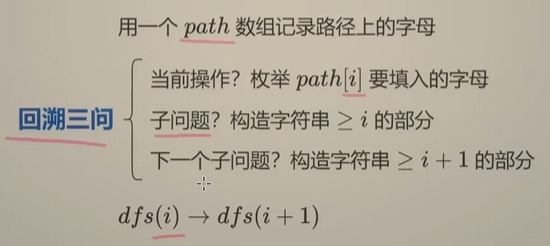
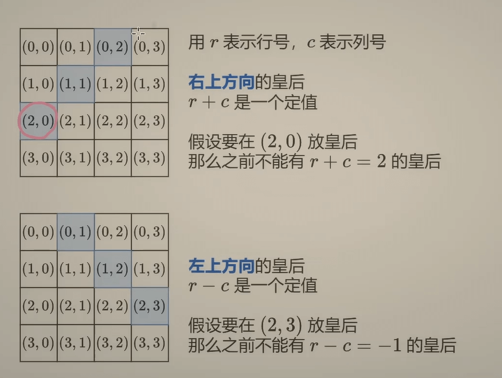

时隔多日再次更新算法学习系列，今天要学习的是回溯算法，本篇文章会介绍三种算法：**子集型回溯**、**组合型回溯**以及**排序型回溯**。
首先我们来介绍一下什么叫做回溯，它是逐步构建问题的解（每一步选择一个可能的选项），若当前选择导致后续无法得到有效解（即 “剪枝”，Pruning），则撤销当前选择（“回溯”），回到上一步重新尝试其他选项。
解决回溯问题的思路与递归类似，我们用path记录路径，先找到dfs（i+1）与dfs（i）的关系，先构建dfs（i）再又关系推dfs（i+1），区别在于当回溯算法满足题目条件时，就把path加入到答案，然后直接返回，从而回到上一个节点的状态，继续推dfs.

我们通过一道题来看看回溯算法是如何解题的：
[17. 电话号码的字母组合](https://leetcode.cn/problems/letter-combinations-of-a-phone-number/description/) 
对于这个问题，如果用for循环直接排列组合，那么会有很多重嵌套，非常复杂，我们可以利用回溯算法，当path长度等于题目所给数字的长度时，那么我们的字母都被一一塞了进去path中，我们就可以把path加入到答案中，如果长度还不够，那我们把下一个数字所对应的字母一一塞进去。
```C++
class Solution {
public:
    vector<string> hash={"abc","def","ghi","jkl","mno","pqrs","tuv","wxyz"}; //引入数组来储存号码所对应字母
    void dfs(int count,string path,const string &digits,vector<string>& ans){
            if(count==digits.length()){  //长度满足题目要求，把path加入答案
                ans.push_back(path);
                return;
            }
            for(int i=0;i<hash[int(digits[count]-'2')].length();i++){ //长度不足的时候，我们把数组中的字母一个个塞进去path中
                dfs(count+1,path+hash[int(digits[count]-'2')][i],digits,ans);  //递归下一个数字
            }
        }
    vector<string> letterCombinations(string digits) {
        vector<string> ans;
        if (digits.empty()) {
            return {};
        }
        dfs(0,"",digits,ans);
        return ans;
    } 
};
```

# 一、子集型回溯
子集型回溯是指集合每个元素有选/不选两种情况，最后输出的是集合的子集。
## 1、子集
我们用最直观的一道题来了解子集型回溯，力扣题目如下：
[78. 子集](https://leetcode.cn/problems/subsets/solutions/2059409/hui-su-bu-hui-xie-tao-lu-zai-ci-pythonja-8tkl/)
这道题我们就可以用刚刚说到的选/不选的思路。
```C++
class Solution {
public:
    void dfs(vector<int>& nums,vector<vector<int>>& ans,vector<int>& path,int i){ 
        if(i==nums.size()){ //这里的话就不是path的长度了，我们引入i来描述第nums[i-1]选或不选，如果i=n那就是都遍历完了
            ans.push_back(path);
            return;
        }
        dfs(nums,ans,path,i+1);// 不选的情况：直接递归i+1
        path.push_back(nums[i]);//选的情况：先加入path中再递归i+1
        dfs(nums,ans,path,i+1);
        path.pop_back(); //恢复现场
    }
    vector<vector<int>> subsets(vector<int>& nums) {
        vector<vector<int>> ans;
        vector<int> path;
        dfs(nums,ans,path,0);
        return ans;
    }
};
```
这里解释一下为什么这道题要**恢复现场**，而我们第一道例题不需要。注意我们dfs函数传入的path，这道题传入的是path的引用，会直接修改path的值，从而对其他层造成影响；但是第一题则是传入path的值，程序会创建一个新的字符串对象，也就是说，下一层递归修改的是 “新副本”，而当前层的path并未被改变。

## 2、分割回文串
力扣题目如下：
[131. 分割回文串](https://leetcode.cn/problems/palindrome-partitioning/solutions/2059414/hui-su-bu-hui-xie-tao-lu-zai-ci-pythonja-fues/)
这道题也可以划分为子集型回溯，因为分割可以看作字符之间的逗号选还是不选，都不选的话就是完整的字符串。
```C++
class Solution {
public:
    bool isPalindrome(string& s, int left, int right) { //判断是否回文
        while (left < right) {
            if (s[left++] != s[right--]) {
                return false;
            }
        }
        return true;
    }
    
    void dfs(string& s, vector<vector<string>>& ans, vector<string>& path, int start) {
        if (start == s.length()) {
            ans.push_back(path);  // 保存当前分割方案
            return;
        }
        
        // 尝试从 start 开始的所有可能子串
        for (int i = start; i < s.length(); i++) {
            if (isPalindrome(s, start, i)) {
                // 如果是回文，加入路径并递归处理剩余部分
                path.push_back(s.substr(start, i - start + 1));
                dfs(s, ans, path, i + 1);
                path.pop_back();  // 回溯，撤销选择
            }
        }
    }
    
    vector<vector<string>> partition(string s) {
        vector<vector<string>> ans;
        vector<string> path;
        dfs(s, ans, path, 0);
        return ans;
    }
};
```
这里有个需要注意的点，我们的path.pop_back()回溯语句是放在了for循环里面，而不是整个dfs函数的最后面，这是为什么呢。因为for循环中的path.push_back(s.substr(start, i - start + 1))也会污染我们的path所以我们要在for循环里面递归完i+1以后马上回溯。

# 二、组合型回溯
组合是比子集要求多一点的回溯，可以看作是长度固定的子集型回溯。
## 1、组合
力扣代码如下：
[77. 组合](https://leetcode.cn/problems/combinations/description/)
这一题也比较简单，他的代码和第二题类似，只不过终止条件变成了path的长度与组合长度k相同
```C++
class Solution {
public:
    vector<vector<int>> ans;
    vector<int> path;
    void dfs(int start,int n, int k){
        if(path.size()==k){
            ans.push_back(path);
            return;
        }
        for(int i=start;i<=n;i++){
        path.push_back(i);
        dfs(i+1,n,k);
        path.pop_back();
        }
    }
    vector<vector<int>> combine(int n, int k) {
        dfs(1,n,k);
        return ans;
    }
};
```
虽然这道题比较简单，但是存在着可以优化的地方，我们可以利用剪枝来减小搜索树的规模。对于dfs函数，我们可以做以下修改，减少程序的用时：
```C++
void dfs(int start,int n, int k){
        if(path.size()==k){
            ans.push_back(path);
            return;
        }
        int d=k-path.size(); //还要选取的数量
        for(int i=start;i<=n-d+1;i++){  //从i开始选，要求n-i+1>=d，意思是n和i之间至少要有d个数
        path.push_back(i);
        dfs(i+1,n,k);
        path.pop_back();
        }
    }
```

## 2、组合总和 III
这道题是上一题的变式，力扣题目如下：
[216. 组合总和 III](https://leetcode.cn/problems/combination-sum-iii/description/)
这道题可以继续沿用上一题的代码，再加个判断，判断当前组合的总和是否等于n
```C++
class Solution {
public:
    vector<vector<int>> ans;
    vector<int> path;
    void dfs(int k,int i,int leftsum){
        if(path.size()==k){
            if(leftsum==0){
               ans.push_back(path); 
            }
            return;
        }
        if(leftsum<0){ //剪枝1：如果现在组合数之和大于n，则直接返回
            return;
        }
        for(int j=i;j>=k-path.size();j--){ //剪枝2：如果剩下的数不够选，就不进入这个循环
            path.push_back(j);
            dfs(k,j-1,leftsum-j);
            path.pop_back();
        }
    }
    vector<vector<int>> combinationSum3(int k, int n) {
        dfs(k,9,n);
        return ans;
    }
};
```
## 3、括号生成
这题可以看作从2n个位置中选n个位置放左括号，剩下n个位置放右括号，力扣题目如下：
[22. 括号生成](https://leetcode.cn/problems/generate-parentheses/solutions/2071015/hui-su-bu-hui-xie-tao-lu-zai-ci-pythonja-wcdw/)
不过这道题还有一个条件是括号一定要合法，那我们应该如何去翻译这个条件呢，我们注意到如果一组括号是合法的话，那我们在遍历时左括号的数量一定**大于等于**右括号的数量，代码如下：
```C++
class Solution {
public:
    vector<string> ans;
    string path;
    void dfs(int i,int open,int n){
        int m=2*n;
        if(i==m){ //终止条件，括号塞满了
            ans.push_back(path);
            return;
        }
        if(open<n){ //左括号未到n，可以继续塞左括号
            path.push_back('(');
            dfs(i+1,open+1,n);
            path.pop_back();
        }
        if(i-open<open){ //左括号数量大于右括号，可以塞右括号
            path.push_back(')');
            dfs(i+1,open,n);
            path.pop_back();
        }
    }
    vector<string> generateParenthesis(int n) {
        dfs(0,0,n);
        return ans;
    }
};
```

# 三、排列型回溯
排列型回溯顾名思义，就是把集合中的元素排列后输出。
## 1、全排列
这题是典型的全排列问题，给定一个数组，让你排列其中的元素，力扣题目如下：
[46. 全排列](https://leetcode.cn/problems/permutations/solution/hui-su-bu-hui-xie-tao-lu-zai-ci-jing-que-6hrh/)
我们可以对每一个位置进行遍历，把没有选过的数字塞进去，最后塞完最后一个位置后，就把它加进答案里面，代码如下：
```C++
class Solution {
public:
    vector<vector<int>> ans;
    void dfs(int i,int n,vector<int>& nums,vector<int>& onpath,vector<int>& path){
        if(i==n){
            ans.push_back(path);
        }
        for(int j=0;j<n;j++){
            if(onpath[j]==0){
                path[i]=nums[j];
                onpath[j]=1; //标记数字已使用
                dfs(i+1,n,nums,onpath,path);
                onpath[j]=0; //恢复现场，因为我们回溯了，所有这个数字回到未使用的状态。
                //path不需要恢复现场，因为我们是直接通过下标访问，直接替换对应元素。
            }
        }
    }
    vector<vector<int>> permute(vector<int>& nums) {
        vector<int> path(nums.size());
        vector<int> onpath(nums.size()); //创建一个数组来记录这个数有没有被选过，这种声明方式长度为nums.size()，默认元素为0
        dfs(0,nums.size(),nums,onpath,path);
        return ans;
    }
};
```
## 2、N皇后
这道题是一道非常经典的排列型回溯的题目，各面试、考试也很爱考，力扣题目如下：
[51. N 皇后](https://leetcode.cn/problems/n-queens/description/)
我们翻译一下题目条件，把n个皇后放入棋盘中，且不可以相互攻击，意思其实是让我们每行每列都只有一个皇后，我们可以用一个数组cols[n]表示第n行皇后的列，这一步枚举类似上一题全排列。那斜线上不能有两个皇后呢，我们可以这样想，把格子看成坐标，那么同一斜线的格子在坐标上会呈以下数字关系：

```C++
class Solution {
public:
    void dfs(vector<int> &col,vector<vector<int>> &jilu,int n,vector<int> &onpath){
        if(col.size()==n){
            for(int i=0;i<col.size();i++){ //判断是否斜着看是否合法
                int a=i+col[i];
                int b=i-col[i];
                for(int j=0;j<col.size();j++){
                    if(j!=i){
                        if(a==j+col[j] ||b==j-col[j]){
                            return;
                        }
                    }
                }
            }
            jilu.push_back(col);
            return;
        }
        for(int i=0;i<n;i++){
            if(onpath[i]==0){ //类似全排列，每一行每一列都只有一个皇后
                onpath[i]=1;
                col.push_back(i);
                dfs(col,jilu,n,onpath);
                col.pop_back();
                onpath[i]=0; //恢复列当前未使用状态
            }
        }
    }
    vector<vector<string>> solveNQueens(int n) {
        vector<vector<string>> ans;
        vector<vector<int>> jilu;
        vector<int> col;
        vector<int> onpath(n);
        dfs(col,jilu,n,onpath);
        for(int i=0;i<jilu.size();i++){
            vector<string> p;
            for(int j=0;j<n;j++){
                string s;
                for(int k=0;k<n;k++){
                    s+='.';
                }
                p.push_back(s);
            }
            for(int j=0;j<jilu[i].size();j++){
                p[j][jilu[i][j]]='Q';
            }
            ans.push_back(p);
        }
        return ans;
    }
};
```
以上代码略显繁琐，无论是时间复杂度和空间复杂度都略显复杂，我们可以修改一下，把判断放入棋子是否合法这一步放到放置这一步，同时一个个遍历去找是否合法也可以再次优化，我们把每一步的r+c与r-c存入到布尔数组中，我们只需查找当前棋子的diag[r+c]与diag[r-c]是否为真，就知道是否合法了：
```C++
class Solution {
public:
    void dfs(vector<int> &col,int n,vector<int> &onpath,vector<int> &diag1,vector<int> &diag2,vector<vector<string>> &ans){
        if(col.size()==n){ //在填充完以后立刻加入到答案中
            vector<string> board(n);
            for (int i = 0; i < n; i++) {
                board[i] = string(col[i], '.') + 'Q' + string(n - 1 - col[i], '.'); //C++支持用加号连接字符串
            }
            ans.push_back(board);
            return;
        }
        for(int i=0;i<n;i++){
            int rc =col.size()-i+n-1;
            if(onpath[i]==0&&diag1[col.size()+i]==0&&diag2[rc]==0){ //分别判断当前列是否合法，当前位置斜向是否有皇后 
                onpath[i]=1;
                diag1[col.size()+i]=1;
                diag2[rc]=1;
                col.push_back(i);
                dfs(col,n,onpath,diag1,diag2,ans);
                col.pop_back();//恢复现场
                onpath[i]=0; 
                diag1[col.size()+i]=0;
                diag2[rc]=0;
            }
        }
    }
    vector<vector<string>> solveNQueens(int n) {
        vector<vector<string>> ans;
        vector<int> col;
        vector<int> onpath(n),diag1(n * 2 - 1), diag2(n * 2 - 1);//第一个vector记录当前列是否被放置过，第二、三个vector记录斜向是否被放置过
        dfs(col,n,onpath,diag1,diag2,ans);
        return ans;
    }
};
```